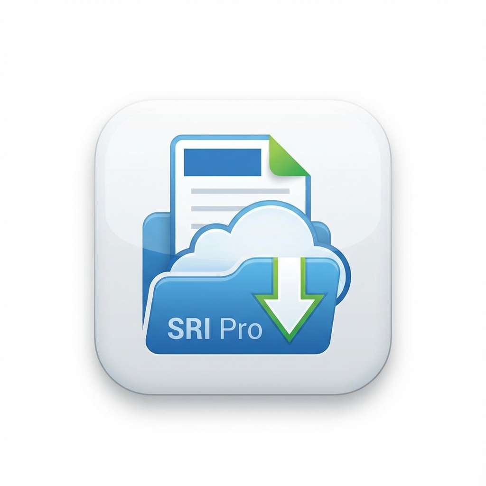

# SRI Pro Downloader 🇪🇨



**SRI Pro Downloader** es una extensión profesional para Google Chrome (v2.4.2) diseñada para facilitar la descarga masiva y gestión de comprobantes electrónicos (XML) desde el portal del SRI en Línea (Ecuador).

## 🚀 Características (v2.4.2)

- **Descarga Masiva**: Descarga múltiples facturas XML con un solo clic.
- **Renombrado Inteligente**: Guarda tus archivos automáticamente con el formato `RUC_FECHA_SECUENCIAL.xml` para fácil contabilidad.
- **Organización Automática**: Configura una carpeta específica (ej: `Facturas/2025`) para mantener tus descargas ordenadas, evitando el desorden en "Downloads".
- **Exportación a Excel**: Genera reportes CSV de tus comprobantes al instante.
- **Robustez Extrema (Nuevo)**: Algoritmo de detección mejorado (v2.4) que encuentra facturas incluso si el sitio del SRI cambia su estructura, leyendo directamente datos de PrimeFaces (`tr[data-ri]`).
- **Dashboard**: Visualiza rápidamente el número de facturas encontradas y el monto total en pantalla.

## 🛠️ Instalación

1. Descarga el código de este repositorio (ZIP) o clónalo:
   ```bash
   git clone https://github.com/jonavez/sri-pro-downloader.git
   ```
2. Abre Google Chrome y ve a `chrome://extensions/`.
3. Activa el **"Modo de desarrollador"** en la esquina superior derecha (interruptor azul).
4. Haz clic en el botón **"Cargar descomprimida"** (Load unpacked).
5. Selecciona la carpeta donde descargaste este proyecto.

## 📖 Cómo Usar

### 1. Escanear Facturas

- Ingresa al portal del [SRI en Línea](https://srienlinea.sri.gob.ec/) -> Facturación Electrónica -> Comprobantes Recibidos.
- Realiza tu consulta (por mes, año, día, etc.) y presiona "Consultar".
- Haz clic en el icono de la extensión **SRI Pro Downloader**.
- Presiona el botón **"🔍 Escanear Página Actual"**. Verás cuántas facturas detectó.

### 2. Descargar XMLs

- Una vez escaneadas, verás el total de facturas y el monto total sumado.
- Presiona **"⬇️ Descargar XMLs"** para bajar los archivos de la página actual.
- O usa **"📑 Descargar Todas las Páginas"** para que la extensión navegue automáticamente por todas las páginas de resultados.

### 3. Configurar Carpeta de Descarga

- Haz clic en el icono de engranaje (⚙️) en la extensión.
- Escribe el nombre de la carpeta deseada (ej: `Mis Facturas/Enero`).
- **Importante**: Para evitar que Chrome te pregunte dónde guardar cada archivo, ve a `chrome://settings/downloads` y desactiva la opción _"Preguntar dónde se guardará cada archivo"_.

## ⭐ Contribuye

Si esta herramienta te ha sido útil y te ha ahorrado tiempo en tus declaraciones de impuestos:

- **Dale una estrella ⭐** a este repositorio. ¡Ayuda a que más personas lo encuentren!
- Si encuentras un error, abre un [Issue](https://github.com/jonavez/sri-pro-downloader/issues).

## 📬 Contacto

- **GitHub**: [Jonathan Chavez](https://github.com/jonavez)

---

Desarrollado con ❤️ por [Jonathan Chavez](https://github.com/jonavez).
