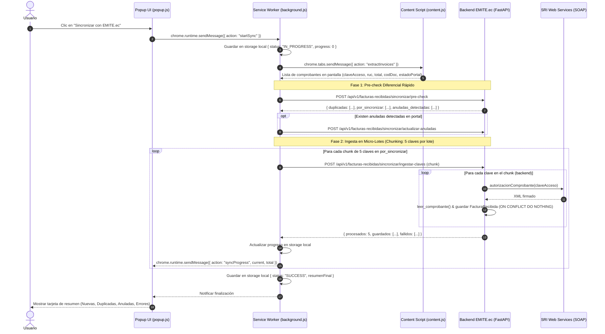

# Especificación Técnica: Sincronización Automatizada SRI Pro Downloader con EMITE.ec

**Identificador**: RFC-2026-001  
**Versión**: 1.0.0 (Aprobado tras Revisión EGM)  
**Fecha**: 2026-11-15  
**Autores**: Equipo de Arquitectura de Integraciones  
**Revisores EGM**: `egm-design` (Design Critic) y `egm-implementation-readiness` (Tech Lead Auditor)  
**Proyecto Extensión**: `sri-pro-downloader` (Chrome Manifest V3)  
**Proyecto Backend**: `facturador-ec/api` (FastAPI / PostgreSQL / SQLAlchemy)

---

## 1. Resumen Ejecutivo

Los usuarios de la plataforma de facturación electrónica **EMITE.ec** (`facturador-ec`) consultan periódicamente en el portal del Servicio de Rentas Internas de Ecuador (**SRI en Línea**) los comprobantes electrónicos recibidos (facturas de proveedores, notas de crédito, retenciones y liquidaciones de compra).

Esta especificación define la arquitectura e implementación de la **sincronización directa en 1 clic** integrada en la extensión `sri-pro-downloader`. Mediante un protocolo diferencial en dos fases con micro-lotes (Chunked Differential Sync), la extensión extrae los comprobantes consultados en el portal, filtra duplicados en milisegundos mediante un pre-check en base de datos, valida el aislamiento multi-tenant y el RUC receptor, procesa las notas de crédito de forma no destructiva, y orquesta la ingesta tolerando caídas y latencias del servicio SOAP del SRI y el ciclo de vida efímero del popup en Chrome Manifest V3.

---

## 2. Decisiones de Arquitectura y Resolución de Hallazgos EGM

Tras la auditoría formal de los revisores EGM, se han incorporado las siguientes decisiones arquitectónicas mandatorias:

1. **Prevención de Timeouts HTTP 504 (Micro-Chunking & Concurrencia Controlada)**:
   - En lugar de enviar un lote masivo síncrono que bloquee el servidor durante 100+ segundos, la extensión envía las claves no registradas en **micro-lotes de máximo 5 claves** (`chunk_size = 5`).
   - Cada micro-lote tiene un timeout estricto de 35 segundos. La extensión actualiza la barra de progreso en tiempo real conforme cada micro-lote se completa.
2. **Corrección de Heurística de Anulación (Integridad Tributaria)**:
   - Se prohíbe taxativamente catalogar un comprobante como `ANULADA` basándose en respuestas `numeroComprobantes == 0` o `NO_ENCONTRADO` del servicio SOAP del SRI, dado que esto corresponde habitualmente a retrasos de replicación del SRI.
   - Un comprobante solo se marca como `ANULADA` si la columna de estado en el portal web del SRI lo indica explícitamente (`estado_portal == 'ANULADO'`) o mediante confirmación formal de revocación.
3. **Aislamiento Multi-Tenant y Seguridad ISO/IEC 27001**:
   - Todo endpoint de actualización o consulta exige obligatoriamente la cláusula `WHERE tenant_id = :current_tenant_id AND clave_acceso IN (:claves)`.
   - El backend valida que el RUC receptor del comprobante (`receptor_ruc`) coincida exactamente con el RUC de la empresa tenant asociada a la credencial. Si no coincide, se rechaza con error `403 Forbidden` (`RUC_RECEPTOR_NO_COINCIDE`).
   - Las credenciales (`apiKey`, `apiUrl`) se guardan exclusivamente en `chrome.storage.local` (nunca en `chrome.storage.sync` para prevenir replicación de secretos).
4. **Ciclo de Vida de Manifest V3 (Service Worker Orchestrator)**:
   - Toda la lógica de sincronización y peticiones de red reside en el Service Worker (`background.js`).
   - El estado de la sincronización se persiste en `chrome.storage.local` (`sync_state`: `IDLE`, `IN_PROGRESS`, `SUCCESS`, `ERROR`).
   - El `popup.js` es un consumidor pasivo: al abrirse, lee el estado de almacenamiento y se suscribe a los mensajes de progreso. Si el usuario cierra el popup, el Service Worker continúa la ejecución sin interrupción.
5. **Tratamiento No Destructivo de Notas de Crédito (`04`)**:
   - Las notas de crédito se registran como comprobantes independientes en `FacturaRecibida` (`cod_doc = '04'`).
   - No modifican el estado de la factura original a `ANULADA`. Si la factura modificada existe, se asocia mediante referencia y se actualiza su saldo o monto compensado. Si no existe, se registran con estado `SUSTENTO_PENDIENTE`.
6. **Extracción Robusta en `content.js`**:
   - La clave de acceso de 49 dígitos se extrae mediante expresión regular `/\b\d{49}\b/` en toda la fila, sin depender de índices fijos de celda.
   - El tipo de documento (`cod_doc`) se extrae de las posiciones 9 y 10 de la clave de acceso (`claveAcceso.substring(8, 10)`).
   - Se extrae el estado visual del comprobante desde la celda de estado del portal SRI.

---

## 3. Protocolo de Comunicación y Diagrama de Secuencia



---

## 4. Requerimientos Detallados para el Backend (`facturador-ec/api`)

El agente desarrollador de `/Users/jona/emite/facturador-ec/api` debe implementar los siguientes contratos de API y modelos:

### 4.1 Endpoint 0: Verificación de Conexión y Credenciales
- **Ruta**: `GET /api/v1/facturas-recibidas/sincronizar/verificar-conexion`
- **Autenticación**: `deps.get_current_tenant_or_api_key`
- **Propósito**: Permite a la extensión comprobar si la API Key es válida y recuperar los datos del tenant para confirmar al usuario en pantalla con qué empresa está conectado.

**Respuesta Exitosa (HTTP 200 OK)**:
```json
{
  "valido": true,
  "empresa_id": 1,
  "ruc": "1790016919001",
  "razon_social": "EMPRESA DE PRUEBA S.A.S.",
  "ambiente_sri": 2,
  "permisos": ["facturas_recibidas:crear", "facturas_recibidas:leer"]
}
```

**Respuestas de Error**:
- `HTTP 401 Unauthorized`: API Key no suministrada o inválida (`{"detail": "Credenciales inválidas o API Key inexistente"}`).
- `HTTP 403 Forbidden`: API Key inactiva o sin permisos (`{"detail": "API Key inactiva o sin permisos para sincronización"}`).

---

### 4.2 Endpoint 1: Pre-Check Diferencial
- **Ruta**: `POST /api/v1/facturas-recibidas/sincronizar/pre-check`
- **Autenticación**: `deps.get_current_tenant_or_api_key`
- **Propósito**: Recibe la lista de comprobantes leídos en el portal y determina cuáles ya existen, cuáles son nuevas y cuáles presentan cambios de estado.

**Modelo de Solicitud (Pydantic)**:
```python
from pydantic import BaseModel, Field
from typing import List, Optional

class ComprobantePreCheckItem(BaseModel):
    clave_acceso: str = Field(..., min_length=49, max_length=49)
    cod_doc: str = Field(..., min_length=2, max_length=2)  # 01, 04, etc.
    emisor_ruc: str = Field(..., min_length=10, max_length=13)
    emisor_nombre: Optional[str] = ""
    total: float
    fecha_emision: str  # Formato DD/MM/YYYY o YYYY-MM-DD
    estado_portal: Optional[str] = "AUTORIZADO"  # AUTORIZADO, ANULADO

class PreCheckRequest(BaseModel):
    comprobantes: List[ComprobantePreCheckItem]
```

**Lógica de Consulta Backend**:
1. Extraer todas las `claves = [c.clave_acceso for c in request.comprobantes]`.
2. Consultar comprobantes existentes del tenant:
   ```sql
   SELECT clave_acceso, estado_sri, cod_doc, total
   FROM facturas_recibidas
   WHERE tenant_id = :current_tenant_id AND clave_acceso IN (:claves);
   ```
3. Consultar comprobantes emitidos internamente hacia el mismo RUC (ventas locales de otros tenants al RUC actual):
   ```sql
   SELECT c.clave_acceso
   FROM comprobante c
   JOIN cliente cl ON c.cliente_id = cl.id
   WHERE cl.identificacion = :current_tenant_ruc AND c.clave_acceso IN (:claves) AND c.estado = 'AUTORIZADA';
   ```
4. Para cada comprobante recibido:
   - Si `clave_acceso` ya existe en `facturas_recibidas`:
     - Si el estado en DB es `AUTORIZADO` y `estado_portal == 'ANULADO'`: agregar a `anuladas_detectadas`.
     - De lo contrario: agregar a `duplicadas`.
   - Si `clave_acceso` ya existe en `comprobante` (interno): agregar a `duplicadas` (origen: `sistema`).
   - Si no existe en ninguna: agregar a `por_sincronizar`.

**Respuesta Exitosa (HTTP 200 OK)**:
```json
{
  "total_analizados": 3,
  "duplicadas": [
    {
      "clave_acceso": "1507202501179001691900120010010000004561234567814",
      "origen": "facturas_recibidas",
      "estado_actual": "AUTORIZADO"
    }
  ],
  "por_sincronizar": [
    {
      "clave_acceso": "1607202501179001691900120010010000004571234567819",
      "cod_doc": "01",
      "emisor_ruc": "1790016919001",
      "total": 54.20
    }
  ],
  "anuladas_detectadas": [
    {
      "clave_acceso": "1407202501179001691900120010010000004551234567810",
      "estado_anterior": "AUTORIZADO",
      "estado_portal": "ANULADO"
    }
  ],
  "resumen": {
    "total": 3,
    "duplicadas_count": 1,
    "por_sincronizar_count": 1,
    "anuladas_count": 1
  }
}
```

---

### 4.3 Endpoint 2: Ingesta por Micro-Lotes de Claves
- **Ruta**: `POST /api/v1/facturas-recibidas/sincronizar/ingestar-claves`
- **Autenticación**: `deps.get_current_tenant_or_api_key`
- **Restricción**: Máximo 5 claves por llamada (`len(claves_acceso) <= 5`). Si se envían más de 5, responder `HTTP 422 Unprocessable Entity`.

**Modelo de Solicitud (Pydantic)**:
```python
class IngestarClavesRequest(BaseModel):
    claves_acceso: List[str] = Field(..., max_items=5)
    ambiente: Optional[int] = 2  # 1 pruebas, 2 producción
```

**Lógica de Ingesta en Backend**:
1. Para cada `clave_acceso`:
   - Consultar al servicio SOAP: `cliente = ClienteSoapSRI(ambiente=ambiente); resp = cliente.autorizar_comprobante(clave_acceso)`.
   - Si la respuesta SOAP es exitosa (`estado == 'AUTORIZADO'` y `xml_autorizado` no nulo):
     - Parsear con `leido = leer_comprobante(xml_bytes)`.
     - **Validación de Seguridad Multi-Tenant**: Validar que `identificacion_corresponde(leido.receptor_identificacion, empresa.ruc)`. Si no corresponde, registrar como fallido con error `"El comprobante fue emitido a otro receptor, no a esta empresa"`.
     - Insertar en `FacturaRecibida` con manejo de duplicados:
       ```python
       nueva = FacturaRecibida(
           tenant_id=empresa.id,
           proveedor_identificacion=leido.emisor_ruc,
           proveedor_nombre=leido.emisor_razon_social or "Proveedor sin razón social",
           clave_acceso=leido.clave_acceso,
           cod_doc=leido.cod_doc,
           version_xml=leido.version,
           fecha_emision=leido.fecha_emision,
           total=leido.total,
           estado_sri=leido.estado,
           numero_autorizacion=leido.numero_autorizacion,
           fecha_autorizacion=leido.fecha_autorizacion,
           ambiente=leido.ambiente,
           verificado_en_sri=True,
           fecha_verificacion_sri=ahora_utc(),
           xml_documento=xml_str,
       )
       db.add(nueva)
       try:
           db.commit()
       except IntegrityError:
           db.rollback()  # Ya existía por concurrencia
       ```
     - Si `leido.cod_doc == '04'` (Nota de Crédito): Buscar si existe la factura modificada y registrar en el log la asociación.
   - Si la respuesta SOAP indica error temporal de red o timeout: registrar en `fallidos` con flag `reintentable: true`.

**Respuesta Exitosa (HTTP 200 OK)**:
```json
{
  "procesados": 1,
  "guardados": [
    {
      "clave_acceso": "1607202501179001691900120010010000004571234567819",
      "numero": "001-001-000000457",
      "proveedor": "PROVEEDOR EJEMPLO S.A.",
      "cod_doc": "01",
      "total": 54.20,
      "estado_sri": "AUTORIZADO"
    }
  ],
  "fallidos": [],
  "total_guardados": 1,
  "total_fallidos": 0
}
```

---

### 4.4 Endpoint 3: Actualización de Facturas Anuladas
- **Ruta**: `POST /api/v1/facturas-recibidas/sincronizar/actualizar-anuladas`
- **Autenticación**: `deps.get_current_tenant_or_api_key`
- **Propósito**: Actualiza el estado de las facturas del tenant que fueron canceladas en el portal SRI.

**Modelo de Solicitud (Pydantic)**:
```python
class ActualizarAnuladasRequest(BaseModel):
    claves_acceso: List[str] = Field(..., max_items=50)
    motivo: Optional[str] = "Detectado como anulado en portal SRI vía extensión"
```

**Lógica de Actualización**:
```python
# Aislamiento multi-tenant estricto: solo actualiza registros del tenant actual
facturas = db.execute(
    select(FacturaRecibida).where(
        FacturaRecibida.tenant_id == empresa.id,
        FacturaRecibida.clave_acceso.in_(request.claves_acceso)
    )
).scalars().all()

actualizadas = []
for f in facturas:
    if f.estado_sri != "ANULADA":
        f.estado_sri = "ANULADA"
        actualizadas.append(f.clave_acceso)
db.commit()
```

**Respuesta Exitosa (HTTP 200 OK)**:
```json
{
  "mensaje": "Comprobantes actualizados correctamente",
  "total_actualizadas": 1,
  "claves_actualizadas": ["1407202501179001691900120010010000004551234567810"]
}
```

---

## 5. Implementación en la Extensión (`sri-pro-downloader`)

### 5.1 Nuevos Módulos y Cambios en Archivos

1. **`emite_sync.js` (Nuevo Módulo ES6)**:
   - Encapsula todas las llamadas HTTP a la API de EMITE.ec (`verificarConexion`, `preCheck`, `ingestarChunk`, `actualizarAnuladas`).
   - Implementa manejo de timeouts con `AbortController` (30 segundos por petición).
   - Maneja cabeceras de autorización `X-API-Key`.
2. **`background.js` (Service Worker)**:
   - Aloja la máquina de estados de sincronización:
     - Escucha el mensaje `{ action: "startSync" }` desde el popup.
     - Guarda en `chrome.storage.local` el estado `{ syncState: "IN_PROGRESS", progress: 0, currentStep: "Extrayendo comprobantes..." }`.
     - Solicita la extracción de datos al `content.js` de la pestaña activa.
     - Llama a `preCheck`.
     - Si hay facturas anuladas, llama a `actualizarAnuladas`.
     - Divide `por_sincronizar` en chunks de 5 y llama a `ingestarChunk` secuencialmente, emitiendo actualizaciones de progreso.
     - Guarda el resultado consolidado en `chrome.storage.local` (`lastSyncResult`).
3. **`content.js`**:
   - Actualizar `extractInvoiceData()`:
     - Buscar la clave de acceso usando regex de 49 dígitos `/\b\d{49}\b/` en toda la fila para evitar fragilidad de celdas.
     - Extraer `cod_doc` a partir de `claveAcceso.substring(8, 10)`.
     - Extraer el texto de la celda de estado del portal SRI (detectando palabras clave como "ANULADO" o "CANCELADO").
4. **`icons.js`**:
   - Agregar íconos SVG: `sync`, `cloudCheck`, `alertTriangle`, `checkCircle`.
5. **`popup.html`**:
   - Botón principal: "Sincronizar con EMITE.ec" (`id="syncEmiteBtn"`).
   - Panel de configuración:
     - Campo URL de API EMITE.ec (`id="emiteApiUrl"`, valor por defecto: `https://api.emite.ec`).
     - Campo API Key (`id="emiteApiKey"`).
     - Botón "Probar Conexión" (`id="testConnectionBtn"`).
     - Badge de estado de conexión (`id="connectionBadge"`).
   - Tarjeta de Resultados de Sincronización (`id="syncResultCard"`):
     - Muestra: Sincronizadas, Duplicadas omitidas, Anuladas detectadas, Notas de crédito recibidas, Errores.
6. **`popup.css`**:
   - Estilos BEM con variables CSS existentes (`:root`): `.btn-sync`, `.sync-card`, `.sync-stat`, `.badge--connected`, `.badge--disconnected`.
   - Cero CSS inline.
7. **`manifest.json`**:
   - Agregar `host_permissions`: `"*://*.emite.ec/*"` y `"*://localhost/*"`.
   - Incrementar versión de `3.2.0` a `3.3.0`.

---

## 6. Normas ISO y Reglas del Proyecto

- **Cero CSS Inline**: Todo estilo reside en `popup.css`.
- **Cero Emojis**: Ningún carácter emoji en archivos de código, HTML, CSS o documentación.
- **Solo Íconos SVG Reutilizables**: Todos definidos en `icons.js`.
- **ISO/IEC 27001 (Seguridad)**: Almacenamiento seguro en `storage.local`, validación de tokens y aislamiento tenant.
- **ISO/IEC 25010 (Calidad)**: Tolerancia a fallos por micro-lotes y separación de responsabilidades.
- **ISO 9241-210 (UX)**: Feedback visual instantáneo con barras de progreso y tarjetas de resumen claras en español.

---

## 7. Instrucciones para el Agente Backend (`facturador-ec/api`)

El desarrollador del backend debe:
1. Crear el router o agregar los 4 endpoints descritos en la sección 4 en `app/api/endpoints/facturas_recibidas.py` (o en un nuevo archivo `app/api/endpoints/sincronizacion_extension.py` incluido en `api.py`).
2. Utilizar `deps.get_current_tenant_or_api_key` como dependencia de autenticación para admitir cabeceras `X-API-Key: <clave>`.
3. Reutilizar `ClienteSoapSRI` y `leer_comprobante` que ya se encuentran implementados y probados en `app/services/sri/`.
4. Asegurar el filtro multi-tenant `tenant_id == empresa.id` en todas las consultas de inserción y actualización.
5. Ejecutar la suite de pruebas unitarias (`pytest tests/`) para verificar que las rutas respondan según los esquemas Pydantic definidos.
